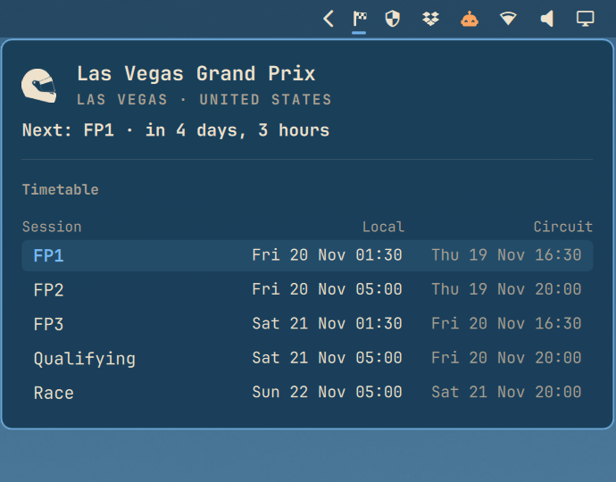

# f1sgui

A spoiler-free Formula 1 schedule for the Omarchy desktop. A small checkered
flag sits in the status bar, left of the tray area. Click it and a panel opens
with the current race weekend: which session is live or next, and the full
timetable in both your local time and the circuit's local time — with no
results, standings, or driver data anywhere, so the weekend stays unspoiled.



## The bar icon

The checkered flag is always visible and follows the Omarchy theme. It does
not change with the session state — the tooltip and the panel carry the
details:

- **Left click** — open/close the timetable panel
- **Right click** — cycle through alternative icons (the other candidates
  drawn during development: alloy wheel, steering wheel, stopwatch; your own
  `wheel.png` and this flag). The choice persists in `shell.json`.
- **Middle click** — refresh the schedule now

Hovering shows the current meeting, circuit, and the next session countdown.

## The panel

- **Hero** — meeting name, circuit, country, with a helmet mark
- **Status line** — `Live now: <session>` while a session runs, otherwise
  `Next: <session> · in 2 days, 5 hours`
- **Timetable** — every session of the weekend with two time columns:
  your local timezone (12/24-hour detected from your zone) and the circuit's
  own offset, the way broadcast times look on-site
- The next upcoming session is highlighted; a live session is highlighted
  further

## Data

Session times come from [OpenF1](https://openf1.org/), which publishes Formula
1 schedule and timing data as an open API. The plugin is only as useful as
that work.

**During a live session**, OpenF1 locks unauthenticated access. The plugin
keeps the season timetable in `~/.cache/f1schedule/schedule.json` — the same
cache file and format the [f1schedule](https://github.com/allandehn/f1schedule)
CLI uses, so the two tools share data. When the API is locked, the plugin uses
that cache, marks the output as cached, and warns if the file is stale relative
to the current race weekend. Requests are paced below OpenF1's 3-per-second
limit and retried on 429s.

The schedule refreshes a few times a day and whenever the panel opens;
the countdown label ticks per minute. Outside of those moments the widget
costs nothing.

## Installing

This is an [Omarchy](https://omarchy.org/) shell plugin (Quickshell bar
widget). On Omarchy, install it the same way as any other plugin:

```bash
omarchy plugin add https://github.com/allandehn/f1sgui --enable
```

That clones the repo, checks it, and asks where in the bar you want the
widget. The flag lands in the bar's `tray` section by default; pick a
different section in the prompt, or move it later with
`omarchy bar move allandehn.f1 --section right`.

On a non-Omarchy system running the Omarchy shell, clone the repo straight
into the plugin directory instead:

```bash
git clone https://github.com/allandehn/f1sgui ~/.config/omarchy/plugins/allandehn.f1
```

The plugin hot-reloads on file changes; `omarchy restart shell` forces a
clean reload. Remove it again with `omarchy plugin remove allandehn.f1`.

## The terminal CLI

The original, terminal-based version lives in
[f1schedule](https://github.com/allandehn/f1schedule) — same spoiler rule,
same cache. This GUI plugin was built to pair with it.

## Files

| File | Purpose |
|---|---|
| `Panel.qml` | Bar widget + panel UI |
| `fetch.sh` | OpenF1 fetch, weekend pick, cache fallback → one JSON object |
| `manifest.json` | Plugin metadata for the Omarchy shell |
| `flag.svg`, `*.svg`, `*.png` | Icon variants (flag is active; see right-click cycling) |

## Credits

Session times come from [OpenF1](https://openf1.org/). Built for
[Omarchy](https://omarchy.org/) and its Quickshell shell.
